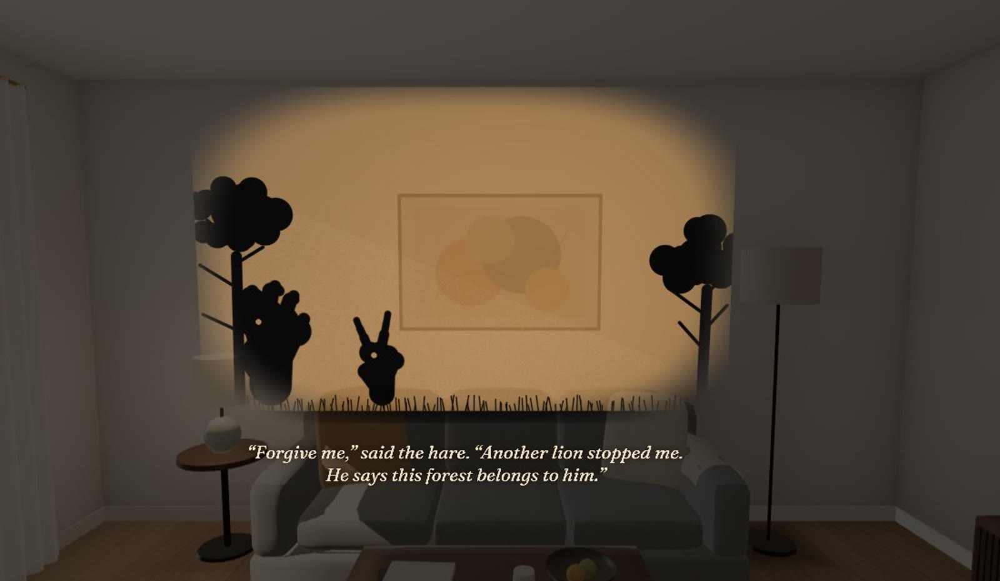
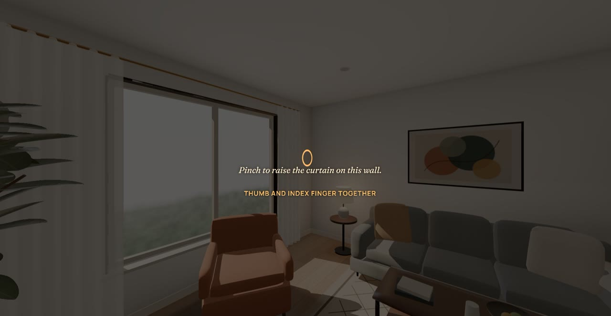
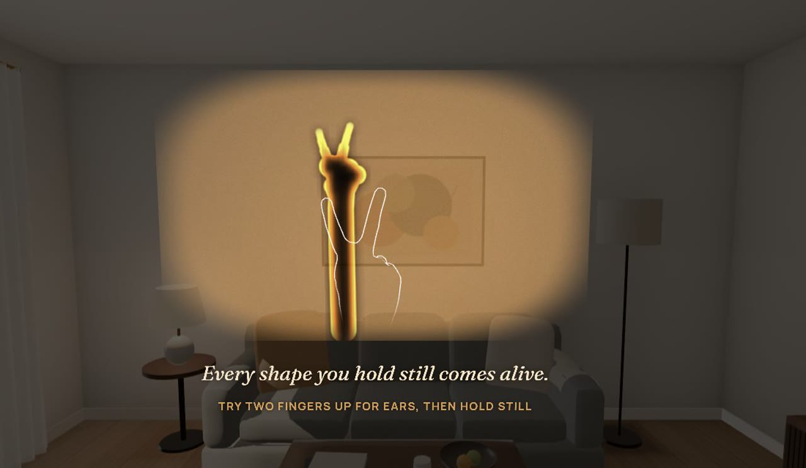
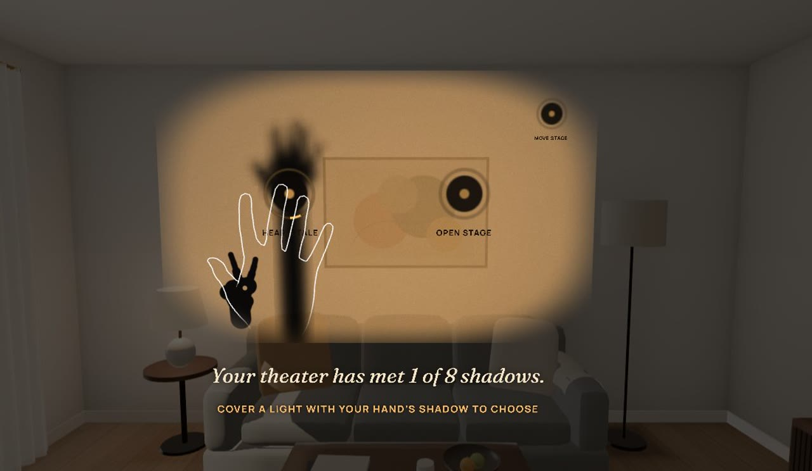
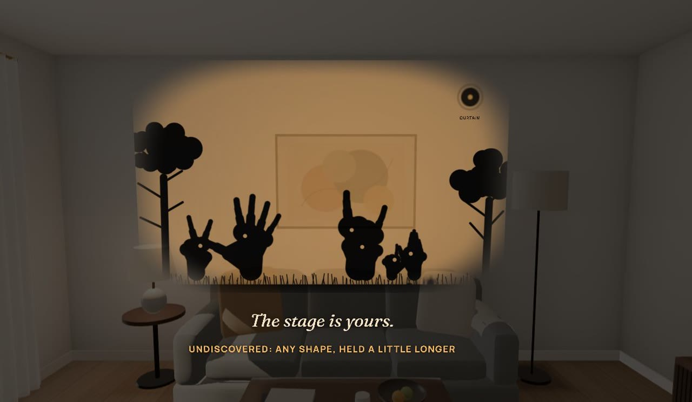
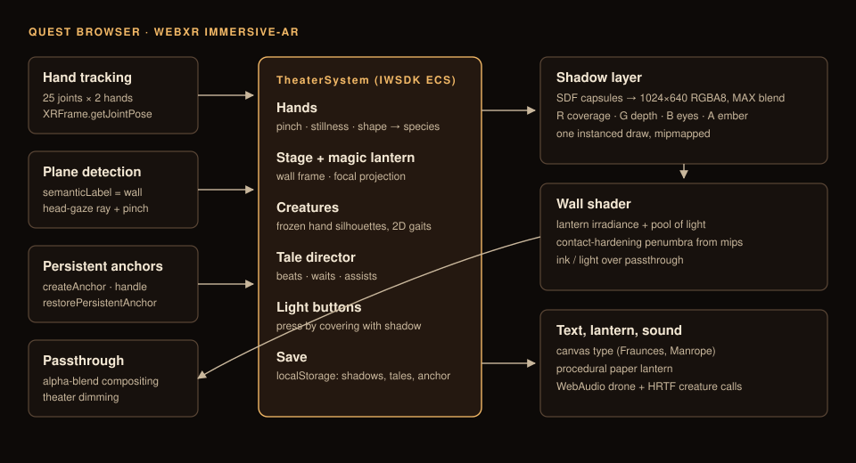

# Chhaya

**A shadow theater for your hands.** A lantern throws your hands' shadows onto your own wall. Hold a shape still, and it comes alive.

Mixed reality for Meta Quest 3 and 3S. Hands only, seated, about eight minutes.

**Play:** open **https://sidd927.github.io/chhaya/** in Meta Quest Browser.
Built for the Meta VR Start Developer Competition 2026 (Entertainment track, New Experience division).



<sub>Screenshots in this README are captured from the running app in Meta's Immersive Web Emulator (IWER 2.8, Quest 3 profile) using its scanned living room as the passthrough stand-in. The rendered hands are the emulator's; on a headset your real hands cast the shadows.</sub>

---

## What it is

*Chhaya* (छाया) means "shadow". Almost everyone has made a hare on a wall with a torch, but the shadow always stays a shadow. Chhaya keeps the real parts of that ritual (your hands, your wall, a light in your room) and adds the impossible one: the shape you hold walks away.

1. **Choose a stage.** Look at a wall in your room and pinch. That wall becomes the stage. No wall in view? A paper screen hangs in front of you.
2. **Raise a hand into the light.** A small paper lantern floats within reach. Your hand's shadow falls on the wall, larger and softer as you move toward the lantern, crisper toward the wall.
3. **Hold a shape still.** The shadow breathes, its edges glow, and it comes alive with your hand's exact silhouette. Two fingers make a hare, a claw a lion, a spread hand a peacock, a fist a tortoise. There are eight to find.
4. **Hear a tale.** *The Lion and the Clever Hare*, from the Panchatantra. You perform every character: carry the hare to the lion by pinching its shadow, lead the lion to the well, and snap your hand open to make him roar at his reflection.
5. **Come back.** Your theater remembers your wall (persistent anchors) and the shadows you have found.

| | |
| --- | --- |
|  |  |
| Look at a wall and pinch | Hold a shape still and it wakes |
|  |  |
| Choose by covering a light with your shadow | Eight shadows to discover |

## Why it has to be mixed reality

- **Your real wall is the stage.** Planes labelled `wall` by the room's scene understanding are offered; wall art, windows and doors are skipped. The stage sizes itself to the wall's distance.
- **Your real hands are the cast.** All 25 tracked joints per hand become the shadow; there is no controller, pointer or panel.
- **Depth is the drama.** Shadow size and softness follow the hand's distance from the lantern (contact-hardening penumbra).
- **It persists.** The stage is held by a WebXR persistent anchor and returns to the same wall next time.

## Hands-first interaction

| Gesture | Meaning |
| --- | --- |
| Look at a wall + pinch | Choose the stage |
| Hold a shape still (~1 s) | Wake a creature |
| Cover a light with your shadow | Choose (a gold ring fills; pinch to confirm at once) |
| Pinch a creature's shadow and move | Carry it |
| Pinch the lantern | Move the light |
| Close your hand, snap it open | Roar |

Every story beat has an assisted path: pinch, or simply wait. Nobody gets stuck.

## How it works



- **Immersive Web SDK 1.1.0 + Three.js**, as an `immersive-ar` WebXR session. Hand tracking, plane detection and anchors are requested as optional features.
- **Shadow layer.** Hands (27 projected capsules each), creatures and scenery are signed-distance capsules drawn in one instanced pass into a mipmapped render target (coverage, occluder depth, eye holes, ember rim). The wall shader turns it into lantern light with penumbra selected from the mip chain by blocker depth.
- **Magic lantern.** The light is focused from a point behind the visible lantern so shadows stay framed on near and far walls.
- **Hand-shape reading.** Per-finger curl and spread, tuned against the hand pose library in Meta's IWER emulator (`npm run tune-shapes`). A relaxed hand reads as nothing; anything else held long enough becomes a wisp, so something always happens.
- **Creatures** are frozen copies of your hand's shadow, animated in 2D by rotating their own finger chains.
- **Sound** is synthesized with WebAudio: a tanpura drone, bell tones, and HRTF-panned creature calls placed on your wall.

More detail in [docs/ARCHITECTURE.md](docs/ARCHITECTURE.md) and [docs/EXPERIENCE_DESIGN.md](docs/EXPERIENCE_DESIGN.md).

## Run it

```bash
npm install
npm run dev          # https://localhost:8081 with the IWER emulator injected
npm run build        # production build to dist/
npm run typecheck
npm run tune-shapes  # checks the shape classifier against IWER's hand poses
```

**On a Quest 3/3S:** open the live URL in Meta Quest Browser, press **Enter the theater**, put the controllers down, sit facing a wall, look at it and pinch. Completing Space Setup first lets Chhaya find your walls. To reset progress, clear site data for `sidd927.github.io`.

**In the emulator:** `npm run dev` opens a managed browser with IWER. Switch the emulated input to hands, enter XR, then use the emulator's hand poses (`peace`, `claw`, `rock`, `open`, `flat`, `fist`, `point`).

## Status and limits

- Developed and verified in Meta's Immersive Web Emulator. **Not yet tested on a physical Quest**; see [docs/TESTING_REPORT.md](docs/TESTING_REPORT.md).
- One tale and eight creature types. No multiplayer, no voice narration (captions only).

## Roadmap

- More tales (*The Tortoise and the Geese*, *The Monkey and the Crocodile*), one per evening.
- Two-handed creatures.
- Shared stages.
- Recording your own shadow plays.
- Shadows across real furniture via the scene mesh.

## Credits and licenses

- Code: MIT (see [LICENSE](LICENSE)). The project began from the IWSDK starter (`npm create @iwsdk`, MIT, Meta Platforms).
- `src/theater/canonical-shapes.json` is derived from IWER's hand pose library (MIT, Meta Platforms).
- Fonts: [Fraunces](https://github.com/undercasetype/Fraunces) and [Manrope](https://github.com/sharanda/manrope), SIL Open Font License 1.1, via Fontsource.
- *The Lion and the Clever Hare* is retold from the Panchatantra (public domain).
- All visuals are procedural and all sound is synthesized; no third-party art or audio is included.
