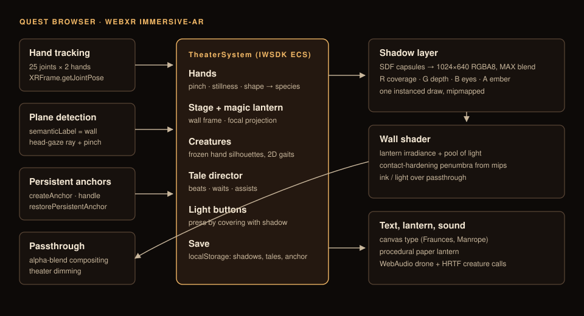

# Architecture

Chhaya is a static WebXR app built with Meta's Immersive Web SDK (IWSDK 1.1.0, Three.js r185). It has no backend; save data lives in `localStorage` on the headset.

## Modules (`src/`)

| File | Responsibility |
| --- | --- |
| `index.ts` | Creates the IWSDK `World` from `iwsdk.config.json` (AR session; hand tracking, anchors and plane detection requested as optional features), registers `TheaterSystem`, hides SDK hand meshes in passthrough, and wires up the landing page. |
| `landing.ts`, `landing.css` | 2D page shown before and after the session: headset capability check, entry button, collection progress. |
| `theater/director.ts` | `TheaterSystem`, the only ECS system. A phase machine (`dim → wall → curtain → first-light → first-shape → menu → tale / open → tale-end`) that each frame reads hands, updates the lantern and projector, runs the phase, updates creatures, renders the shadow layer and updates text. |
| `theater/hands.ts` | Reads the 25 WebXR joints per hand from `XRFrame.getJointPose` and derives a palm centre, elbow, pinch with hysteresis, speed and stillness, shape reading, and the "open burst" gesture. Holds `HAND_BONES`, the 27 capsules that make up a hand's shadow. |
| `theater/hand-shape.ts` | Pure shape reading: finger curl, spread, thumb reach, pinch gap, classification into species. Has no imports, so Node can run it in `scripts/tune-shapes.ts`. |
| `theater/stage.ts` | Wall frame (origin, right, up, normal, size), point projection from a light onto the wall, and the wall shader (lantern light plus contact-hardening shadow, or a washi paper screen). |
| `theater/shadow-layer.ts` | 2D signed-distance capsules drawn as instanced quads into a mipmapped render target. |
| `theater/creature.ts` | A creature is a frozen copy of the projected hand: normalised, detached from its forearm, then animated in 2D by rotating its own finger chains. Each species has its own gait. |
| `theater/scenery.ts` | Grass, trees, a village well, the moon (with the saved hare silhouette) and a flickering fire, all built from the same capsules. |
| `theater/tale.ts` | Two tales as data (*The Lion and the Clever Hare*, *The Hare in the Moon*): narration, instruction, hold time, a wait condition, an assist. The director plays the first tale not yet heard, then alternates. |
| `theater/lantern.ts` | Procedural paper lantern (lathe and rib geometry, glow sprites), flicker, and pinch-grab. |
| `theater/text.ts` | Canvas typography (bundled Fraunces and Manrope, OFL), cross-fading `TextPlane`, and `LightButton` ink medallions with a progress ring. |
| `theater/audio.ts` | All sound synthesized with WebAudio, with HRTF panning for creature sounds. |
| `theater/save.ts` | Discovered species, finished tales, last tale, visit count, tutorial flag, the persistent stage anchor record, and the moon hare (a normalised silhouette). |
| `theater/canonical-shapes.json` | Reference 2D silhouettes per species, generated from IWER's MIT-licensed pose library (`scripts/make-canonical-shapes.ts`), used by the assist summons. |

## The shadow pipeline

1. **Projection.**
   - Each of a hand's 27 points is projected from the light's focal point onto the wall plane, giving a 2D stage position, a scale factor and a depth fraction (0 at the lantern, 1 at the wall).
   - Bone radii are scaled by the projection.
   - Points behind the light are rejected; an elbow behind it is tucked under the wrist.
2. **The magic lantern.**
   - A true point light 30 cm from a hand magnifies its shadow about 10× on a 3 m wall.
   - The light is therefore focused from a point behind the visible lantern along the wall normal, at `focal = max(0, (D − 1.02) / 2.4)`, where D is the lantern-to-wall distance.
   - With that focal point, a hand 30 cm in front of the lantern casts a shadow about 3.4× its size on any wall.
   - Moving closer to the lantern still makes shadows larger and softer.
3. **Shadow layer.**
   - Hands, creatures, scenery and the well reflection are all capsules: `push(ax, ay, bx, by, radius, depth, ember, kind)`.
   - One instanced draw renders them into a 1024 × ~640 RGBA8 target with MAX blending. The channels are:
     - R: coverage
     - G: coverage × depth
     - B: creature eyes, holes that let light through
     - A: ember rim
   - The pass toggles `renderer.xr.enabled` off, so three.js doesn't substitute the XR camera, and restores the frame's render target and clear colour afterwards.
4. **Wall shader.**
   - Lantern irradiance: `(d/dist)^2.4`, shaped by a superellipse pool.
   - Contact-hardening shadow:
     - A coarse mip gives the average blocker depth.
     - Penumbra = `lightSize × (1 − blocker) / blocker`, which selects the mip level for a 5-tap filter.
     - Shadows thrown from near the lantern are wide and soft; near the wall they are crisp.
   - It writes warm light or near-black ink with alpha over passthrough (`alpha-blend`), and adds grain and an ember rim.

Cost per frame: one draw of up to ~400 instanced quads into a small target, plus one wall quad with about 8 texture reads per fragment. **Not measured on Quest hardware**; see `TESTING_REPORT.md`.

## Wall selection

- Reads `XRFrame.detectedPlanes`.
- Keeps vertical planes whose `semanticLabel` is `wall` (or that have no label and are at least 1.2 m wide).
- Computes each plane's extents in wall axes and casts the head-gaze ray against them.
- On pinch, centres the stage where the lantern throws a natural hand pose, clamped to the wall's extents.
- The stage is then anchored with `XRFrame.createAnchor` and `XRAnchor.requestPersistentHandle()`, both feature-detected. On the next visit, `XRSession.restorePersistentAnchor(uuid)` puts it back.

## Gotchas found and handled

- IWSDK replaces an object's `position` vector when it becomes an entity, so references are never cached; `Lantern.position` is a getter.
- In an XR frame, three.js swaps any camera for the headset camera; offscreen passes disable XR temporarily.
- The emulator starts in controller mode; the app prompts for hands if neither is tracked.

## Build and tooling

- Vite 7 through `@iwsdk/vite-plugin-dev`.
- `npm run build` produces `dist/` (about 3.7 MB; main chunk 680 KB gzipped). The relative base (`./`) works on the GitHub Pages subpath.
- Dev-only tooling in `scripts/dev/` drives the IWER emulator through the IWSDK CLI: scripted walkthroughs, footage capture, and a console geometry beacon (`[chhaya] geo …`, emitted only in development).
